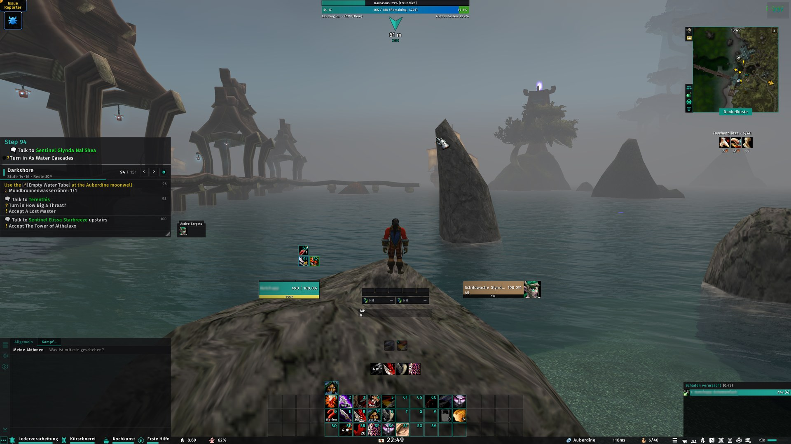
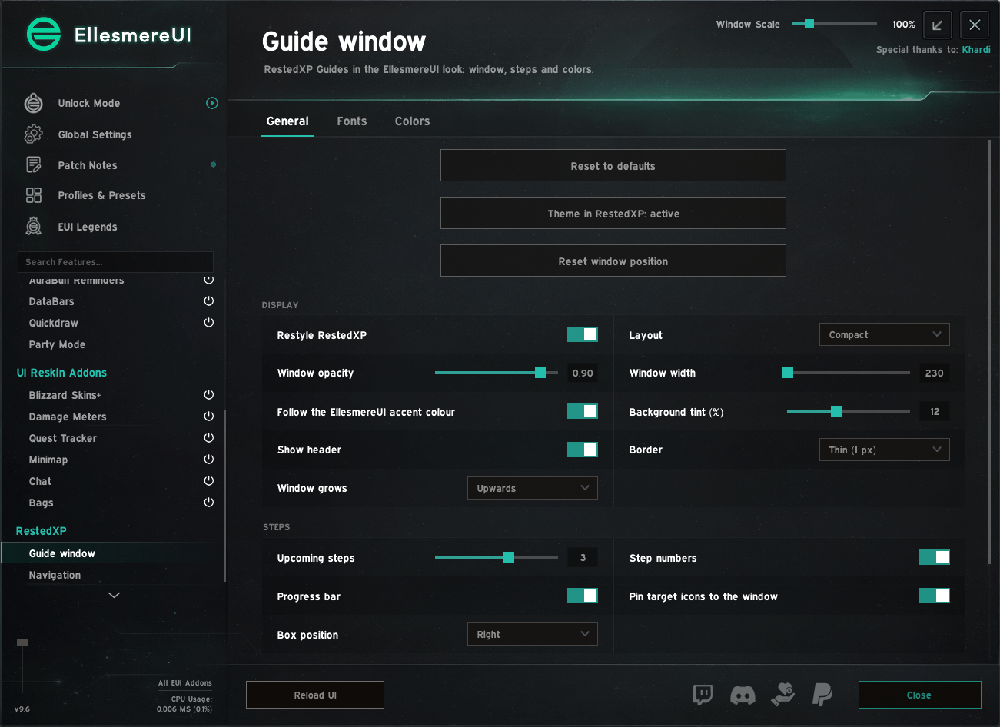
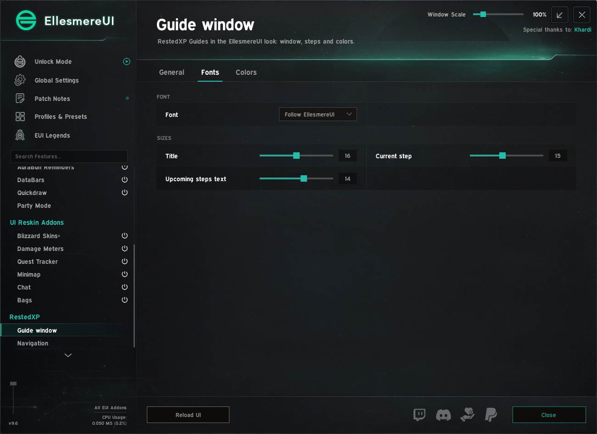
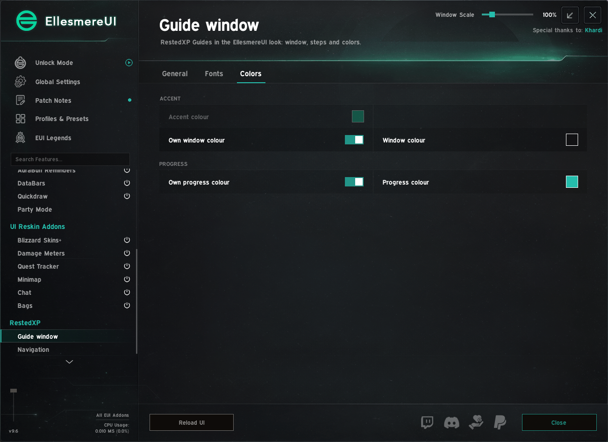
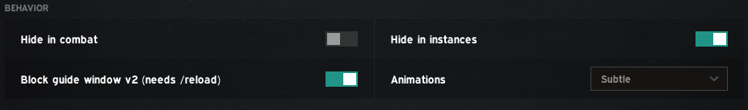
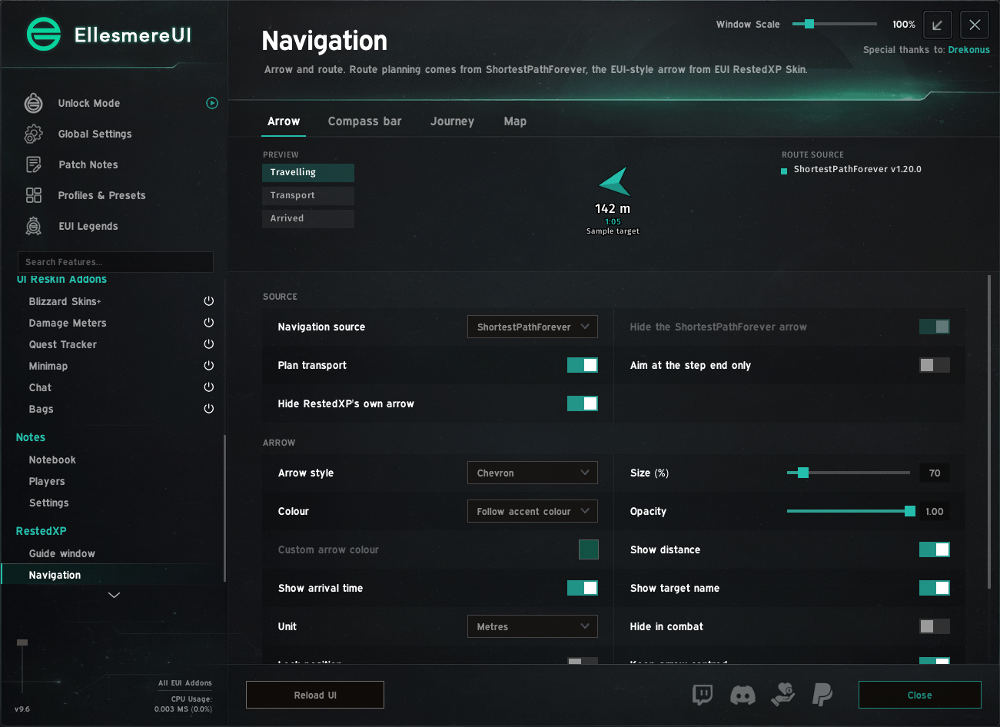
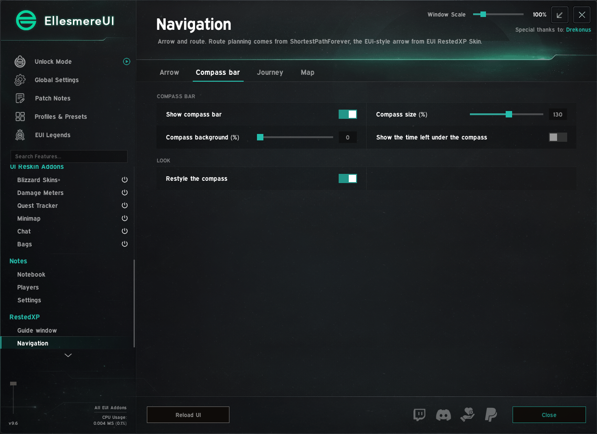
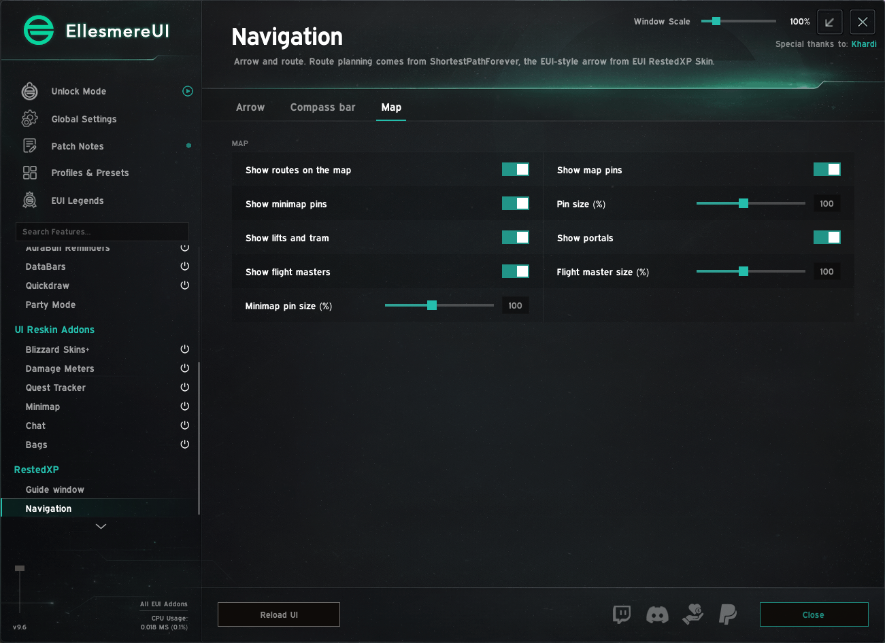
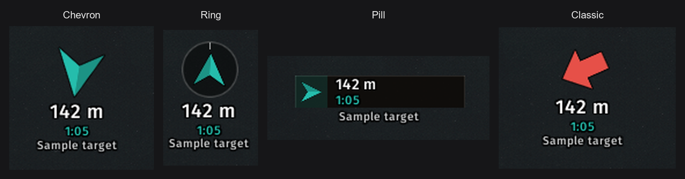

# EUI RestedXP Skin

A skin for **World of Warcraft: Forever**. It shows the RestedXP guide window in the look of EllesmereUI,
follows the EllesmereUI accent colour live, and adds an arrow that points along the route planned by
ShortestPathForever.

> **Unofficial.** This addon is not affiliated with or endorsed by RestedXP or EllesmereUI.
> Both addons are required and are installed separately. No code, graphics or fonts from either addon are included.

## Requirements

| Addon | Needed | Download |
|---|---|---|
| RestedXP Guides | required | [CurseForge](https://www.curseforge.com/wow/addons/restedxp-guide) |
| EllesmereUI | required | [CurseForge](https://www.curseforge.com/wow/addons/ellesmereui) |
| ShortestPathForever | optional (route and transports for the arrow, Journey and compass skin) | [CurseForge](https://www.curseforge.com/wow/addons/shortest-path-forever) |

EUI RestedXP Skin only loads when RestedXP Guides and EllesmereUI are both installed and enabled.
Without ShortestPathForever the arrow points in a straight line to the step target.

## Features

- **Guide window** in the EllesmereUI style: header with step counter, progress bar and step buttons, current step
  with goals and counters, list of upcoming steps (the mouse wheel scrolls through the whole guide).
- **Colours:** follows the EllesmereUI accent colour; own accent, window and progress colours are optional;
  fonts from EllesmereUI or the game.
- **Item and target boxes** are pinned to an edge of the window. Drag a box to move it along the edge or to another
  edge; an accent line shows where it will dock. They stay usable in combat.
- **Navigation arrow** in four styles with distance, ETA and target name; states for travelling, transport
  (flight path, boat, zeppelin, lift, tram, portal, teleport) and arrival.
- **ShortestPathForever's Journey and compass** in the EllesmereUI look: the Journey section of the objective
  tracker matches the EllesmereUI quest tracker (accent header with a thin line, its fonts and colours, a dark
  panel behind it, the current step in the accent colour); the compass gets accent ticks, centre mark and
  walking marks, the EllesmereUI font and the window colour behind the band.
- Optional: hide the window in combat and/or in instances, block RestedXP's guide window v2.
- English and German.

## Usage

All settings are in the EllesmereUI options window, section **RestedXP**. Open it with `/euirxp`, with a
right-click on the cog in the guide header, or from the addon compartment.

| Command | Effect |
|---|---|
| `/euirxp` | open the options |
| `/euirxp lock` / `unlock` | lock or unlock the arrow for dragging |
| `/euirxp probe` | print diagnostic information for bug reports |
| `/euirxp spf` | show whether the Journey and compass skin found ShortestPathForever's frames |

"Restyle RestedXP" off gives you RestedXP's own look back; "Reset to defaults" restores every value the skin
changed in RestedXP and ShortestPathForever.

## Installation

Install from CurseForge, or copy the `EUI_RestedXP_Skin` folder into
`World of Warcraft/_classic_beta_/Interface/AddOns/` (the folder name must stay exactly `EUI_RestedXP_Skin`).

## Support

Bug reports and ideas: [GitHub Issues](https://github.com/HeartOfD2/EUI-RestedXP-Skin/issues). Please include the
output of `/euirxp probe` and the full Lua error text.

## Licence

MIT, see [LICENSE](LICENSE). RestedXP, EllesmereUI and ShortestPathForever belong to their respective authors.
